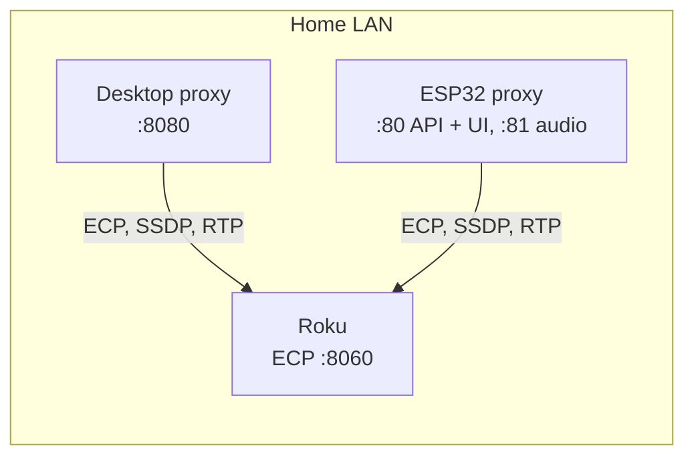
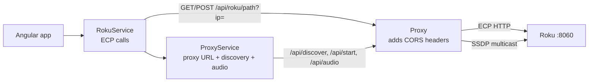
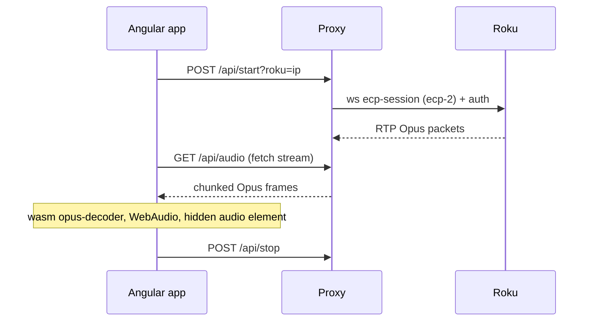
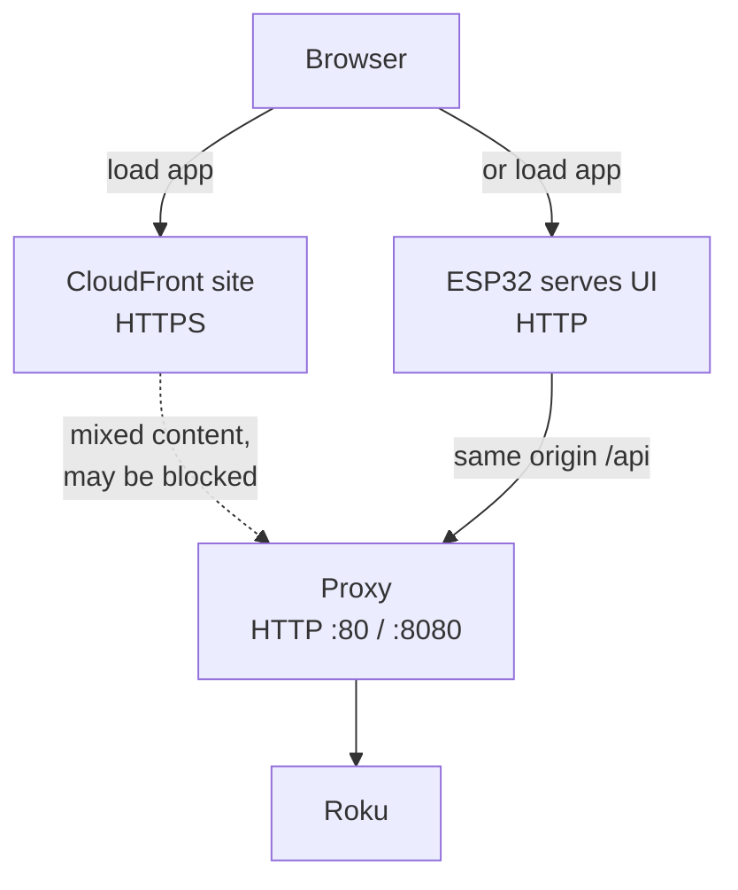
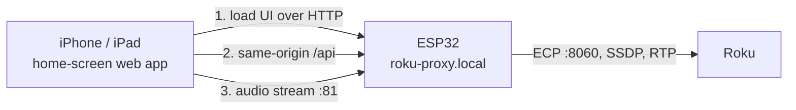
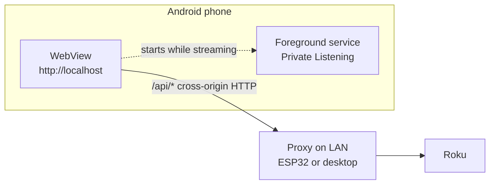

# How the proxy works in each scenario

The Roku doesn't send CORS headers, so the app never talks to it directly.
Every request goes browser → **proxy** → Roku. The proxy is needed in every
scenario below; what changes is **where the proxy is hosted** and **where the
page is loaded from** (which decides whether the browser blocks the plain-HTTP
proxy as mixed content).

Links are to `master` on
[BlueFin605/rokuremote](https://github.com/BlueFin605/rokuremote). GitHub
doesn't render mermaid `click` links, so each diagram is followed by a table
mapping its boxes to code.

## Where the proxy is hosted

There are two builds of the same proxy (the ESP32 is a parallel port, not a
shared binary):

| | Desktop proxy | ESP32 proxy |
|---|---|---|
| Runs on | A PC/Mac/Pi on the LAN | An always-on ESP32 on the LAN |
| API port | 8080 (`--port`) | 80 |
| Audio stream | Same port, `/api/audio` | Second server on API port + 1 (81) |
| Serves the web UI | No | Yes — Angular build embedded in firmware |
| Name | Host IP/name you configure | mDNS `roku-proxy.local`, or router DNS `roku-proxy` |

| Box | Code |
|---|---|
| Desktop proxy | [`proxy/src/main.cpp`](https://github.com/BlueFin605/rokuremote/blob/master/proxy/src/main.cpp) (ports), [`proxy/src/http_server.cpp`](https://github.com/BlueFin605/rokuremote/blob/master/proxy/src/http_server.cpp) (routes, CORS, ECP forward) |
| ESP32 proxy | [`esp32/main/main.cpp`](https://github.com/BlueFin605/rokuremote/blob/master/esp32/main/main.cpp) (mDNS), [`esp32/main/http_server.cpp`](https://github.com/BlueFin605/rokuremote/blob/master/esp32/main/http_server.cpp) (routes, CORS, static UI, audio server on port + 1), [`esp32/scripts/prepare_web.sh`](https://github.com/BlueFin605/rokuremote/blob/master/esp32/scripts/prepare_web.sh) (embeds the Angular build) |
| Roku ECP | Forwarded to port 8060 — desktop `http_server.cpp`, ESP32 `http_server.cpp` |

## What every scenario shares

| Box | Code |
|---|---|
| ProxyService | [`proxy.service.ts`](https://github.com/BlueFin605/rokuremote/blob/master/app/src/app/services/proxy.service.ts) — URL stored in localStorage `proxy-url`, default `http://roku-proxy` |
| RokuService | [`roku.service.ts`](https://github.com/BlueFin605/rokuremote/blob/master/app/src/app/services/roku.service.ts) — `rokuUrl()` builds `<proxy>/api/roku/<path>?ip=<ip>` |
| Proxy | [desktop `http_server.cpp`](https://github.com/BlueFin605/rokuremote/blob/master/proxy/src/http_server.cpp) / [ESP32 `http_server.cpp`](https://github.com/BlueFin605/rokuremote/blob/master/esp32/main/http_server.cpp) — `Access-Control-Allow-Origin: *` and `Allow-Private-Network` |
| SSDP discovery | [`proxy/src/ssdp_discovery.cpp`](https://github.com/BlueFin605/rokuremote/blob/master/proxy/src/ssdp_discovery.cpp), [`esp32/main/ssdp_discovery.cpp`](https://github.com/BlueFin605/rokuremote/blob/master/esp32/main/ssdp_discovery.cpp). The Discover button only shows when a proxy is reachable. |
| TV control (Panasonic) | [`tv.service.ts`](https://github.com/BlueFin605/rokuremote/blob/master/app/src/app/services/tv.service.ts) → `/api/tv/*` → [`proxy/src/panasonic_handler.cpp`](https://github.com/BlueFin605/rokuremote/blob/master/proxy/src/panasonic_handler.cpp) |

### Private listening (audio)

Identical in every scenario. The proxy is the Roku's audio client; the browser
just plays an HTTP stream.

| Step | Code |
|---|---|
| start / stop | `ProxyService.startListening` in [`proxy.service.ts`](https://github.com/BlueFin605/rokuremote/blob/master/app/src/app/services/proxy.service.ts) |
| Roku session + RTP | [`proxy/src/roku_session.cpp`](https://github.com/BlueFin605/rokuremote/blob/master/proxy/src/roku_session.cpp), [`rtp_receiver.cpp`](https://github.com/BlueFin605/rokuremote/blob/master/proxy/src/rtp_receiver.cpp), [`roku_auth.cpp`](https://github.com/BlueFin605/rokuremote/blob/master/proxy/src/roku_auth.cpp) (ESP32 copies in `esp32/main/`) |
| Audio URL | `ProxyService.getAudioStreamUrl` — on the ESP32 it points at port 81 |
| Decode + play | [`audio-player.service.ts`](https://github.com/BlueFin605/rokuremote/blob/master/app/src/app/services/audio-player.service.ts) — decoded audio feeds a `MediaStreamDestination` attached to a hidden `<audio>` element so playback survives screen lock |

## Scenario 1 — web page in a browser

The page is the CloudFront site over HTTPS. The proxy is plain HTTP, so the
browser may treat calls to `http://roku-proxy` as mixed content and block
them. localhost is exempt, which is why local development works.

Loading the UI from the ESP32 instead (`http://roku-proxy/`) avoids this: page
and API share an origin, and `ProxyService` switches to relative `/api` paths.

| Box | Code |
|---|---|
| CloudFront site | CDK stack in [`infra/`](https://github.com/BlueFin605/rokuremote/tree/master/infra), deployed by Home's `deploy-rokuremote.yml` |
| ESP32 serves UI | static handler `/*` in [`esp32/main/http_server.cpp`](https://github.com/BlueFin605/rokuremote/blob/master/esp32/main/http_server.cpp) |
| Same-origin detection | `detectDefaultUrl` in [`proxy.service.ts`](https://github.com/BlueFin605/rokuremote/blob/master/app/src/app/services/proxy.service.ts) — hostname `roku-proxy`, `roku-proxy.local` or `192.168.*` with no port |
| Service worker | enabled only for non-dev, non-native builds — [`app.config.ts`](https://github.com/BlueFin605/rokuremote/blob/master/app/src/app/app.config.ts) |

## Scenario 2 — Apple device with an ESP32

There is no iOS-specific code: an iPhone/iPad home-screen install is the same
web build as scenario 1. The ESP32 is the practical proxy because it serves
the UI over HTTP, so there is no mixed-content block to work around.

| Box | Code |
|---|---|
| ESP32 | [`esp32/`](https://github.com/BlueFin605/rokuremote/tree/master/esp32); flash and Wi-Fi setup in [`local-development.md`](https://github.com/BlueFin605/rokuremote/blob/master/local-development.md) and [`docs/esp32-macbook.md`](https://github.com/BlueFin605/rokuremote/blob/master/docs/esp32-macbook.md) |
| mDNS name | [`esp32/main/main.cpp`](https://github.com/BlueFin605/rokuremote/blob/master/esp32/main/main.cpp) |
| Audio keep-alive | hidden `<audio>` element and MediaSession in [`audio-player.service.ts`](https://github.com/BlueFin605/rokuremote/blob/master/app/src/app/services/audio-player.service.ts) |

## Scenario 3 — Android app

The Android app **still needs a proxy** (ESP32 or desktop) on the LAN. There
is no native HTTP, SSDP or ECP code. What the native shell adds is:

- A WebView loaded from `http://localhost` with cleartext and mixed content
  allowed, so the plain-HTTP proxy is reachable from an installed app.
- A foreground service so private listening continues with the screen off.
- Over-the-air web-bundle updates.

Because the hostname is `localhost`, the proxy URL falls back to the default
`http://roku-proxy` (or whatever is saved in setup).

| Box | Code |
|---|---|
| WebView config | [`app/capacitor.config.ts`](https://github.com/BlueFin605/rokuremote/blob/master/app/capacitor.config.ts) — `androidScheme: 'http'`, `cleartext`, `allowMixedContent` |
| Android project | [`app/android/`](https://github.com/BlueFin605/rokuremote/tree/master/app/android) |
| Foreground service | [`native-background.service.ts`](https://github.com/BlueFin605/rokuremote/blob/master/app/src/app/services/native-background.service.ts), started from `AudioPlayerService.start()` |
| Native detection | `Capacitor.isNativePlatform()` in [`native-info.service.ts`](https://github.com/BlueFin605/rokuremote/blob/master/app/src/app/services/native-info.service.ts) and [`setup.component.ts`](https://github.com/BlueFin605/rokuremote/blob/master/app/src/app/views/setup/setup.component.ts) |
| OTA updates | [`update.service.ts`](https://github.com/BlueFin605/rokuremote/blob/master/app/src/app/services/update.service.ts) (the only use of `CapacitorHttp`, for the update manifest) |

## At a glance

| | Browser (HTTPS site) | Apple + ESP32 | Android app |
|---|---|---|---|
| Proxy needed | Yes | Yes | Yes |
| Page origin | `https://` CloudFront | `http://roku-proxy` (ESP32) | `http://localhost` (WebView) |
| Mixed content | May be blocked | None (same origin) | Allowed by config |
| Proxy URL | Saved or default | Relative `/api` | Saved or default |
| Keeps audio on lock | Hidden `<audio>` element | Hidden `<audio>` element | Foreground service |
